# Architecture



The shape is **inputs → signals → decision → audit**, with one action path after the decision.

## 1. Inputs

| Input | Where it comes from | Trusted? |
|---|---|---|
| operation and params | model output, parsed by `models.parse_proposal` | No. Strict schema, unknown fields rejected, bounded sizes, bool/int/string values only |
| who is asking | the `X-API-Key`, resolved to a principal | Yes. Never read from the body |
| agent grants | `principals.grants`: operation, environments, optional cap | Yes |
| active policy | `policies` table, versioned by hash | Yes |
| kill switch, clock | database row, injected clock | Yes |

## 2. Signals

The service gathers these before calling the engine. The engine never touches the database.

- **Verified facts**: does the ticket exist, is it open, is it the right kind; how many records does the segment really hold; how much of the payment is left; how many replicas does the service run.
- **Cumulative use**: quantity this agent, and all agents, have already had decided in the policy's window (default 24h). Queued, pending, approved and executed actions all count, so waiting for a human doesn't reset the clock.
- **Derived**: reversibility (hard delete, external export and transfers are irreversible), effective quantity (the larger of the agent's claim and the data), and whether the claim contradicts the data.

## 3. Decision

`engine.evaluate(operation, params, context) -> Decision`. Pure: no I/O, clock, randomness or model.

Precedence: **refuse > ask > defer > escalate > execute**.

| Outcome | When | What the caller gets |
|---|---|---|
| refuse | no grant, wrong environment, kill switch, over a hard limit or cap, refund larger than what's left, unknown operation | reasons and evidence |
| ask | missing or malformed fields, ticket not found or wrong kind, claim contradicts the data | `missing_information`: what to fix |
| defer | outside the prod change window | `retry_after` |
| escalate | over an automatic limit (per action or cumulative), irreversible, or risk score at or above 60 | an approval request naming the action hash |
| execute | within every limit | queued for the worker |

**Risk score** (integer arithmetic, 0–100, so the TypeScript port matches exactly): reversibility 0/15/35, plus magnitude up to 30 (relative to four times the automatic limit), plus 10 for PII, 10 for prod, up to 20 for cumulative pressure, 10 for a contradicted claim. In the default policy the limits do the deciding; the score is the explanation, and a backstop if someone loosens the limits.

**Confidence** starts at 100: minus 20 if a claim didn't check out, 5 if the environment was assumed, 10 if an executing action sits within 20% of its automatic limit. It's a cue for the reviewer, not a calibrated probability.

The policy is one JSON file (`src/countersigned/default_policy.json`): numbers, required fields, lists. The meaning of each operation (how to compute the blast radius, what is irreversible) lives in per-operation resolvers in `engine.py`. A policy change gets a new version hash; a resolver change is a code change.

## 4. Audit and action

One transaction at decision time writes the `actions` row, a `decision` audit entry (the proposal, the decision, **and the full inputs it depended on**), and an `outbox` row if it's allowed to run.

```
propose ──► decision + audit + outbox (one txn) ──► worker ──► effect ──► executed event
                    │                                  ▲
          pending_approval ── human approves hash ─────┘ (approval row + outbox row, one txn)
```

The worker claims one outbox row (`FOR UPDATE SKIP LOCKED`), takes the kill-switch row `FOR SHARE`, re-evaluates with `mode="execute"` under the **current** policy, and only then acts. A human approval lifts `escalate`, never `refuse`, `ask` or `defer`, and only if the approval still matches the action hash, is unused and unexpired. The effect runs in a savepoint and checks its own row counts; if the world changed, it rolls back and the action is `blocked`.

**Audit log**: each entry's hash covers the previous hash and the canonical JSON of the entry. `UPDATE`, `DELETE` and `TRUNCATE` are refused by triggers. `verify` recomputes the chain and reports the first bad entry. `replay` re-runs a stored decision from its stored inputs and compares.

## Locks, in the order they are taken

1. `7001`: the decision lock. One proposal at a time, so cumulative-window arithmetic is exact under concurrency.
2. Row locks: the action (`FOR UPDATE`), the kill switch (`FOR SHARE` in workers, `FOR UPDATE` when toggled).
3. `7002`: the audit lock, so the chain can't fork.

A single global lock for decisions is simple and correct and limits throughput. The fix, if it ever matters, is to shard it by agent and operation family.

## Tables

`policies`, `principals`, `kill_switch`, `actions`, `approvals`, `executions`, `outbox`, `audit_log`, and the simulated business (`sim_customers`, `sim_tickets`, `sim_payments`, `sim_services`, `sim_exports`, `sim_transfers`). `schema.sql` is idempotent and runs at startup.

## The browser demo

`web/src/engine.ts` is a line-for-line port of the engine, and `web/src/sim.ts` is an in-memory gate with the same states. They are checked against the Python service with shared fixtures: 57 decision cases (compared whole, evidence text included), hash vectors (canonical JSON, action hashes, the audit chain), and 25 scenarios whose final statuses were recorded from the Python service running on Postgres. It cannot show real concurrency; the Python tests cover that.
